# Brahma Echo — Architecture

**Repository:** `D:\ULTRON\Brahma-Echo-main`
**Document scope:** implemented architecture, runtime workflows, data flow, security boundaries, and known limitations.
**Method:** derived from source inspection (`main.py`, `ui.py`, `core/`, `agent/`, `actions/`, `brahma_connect/`, `dashboard/`, `smart_home/`, `memory/`, `workspace_store.py`). README marketing claims are separated from verified behavior where they differ.

---

## 1. What Brahma Echo Is

Brahma Echo is a Windows-first, voice-controlled desktop AI assistant. It combines:

- A **PyQt6 desktop application** with a holographic HUD, chat workspace, settings, and device pages.
- A **Gemini Live API audio session** (`google-genai`) that streams microphone audio to Gemini and streams synthesized speech back.
- A **tool/function-calling layer** with 52 declared tools covering desktop control, files, Office generation, browser automation, Google Workspace, Instagram, diagnostics, smart home, and device orchestration.
- A **multi-step agent subsystem** that can plan, queue, execute, retry, and replan tasks.
- A **self-healing subsystem** that records tracebacks, analyzes them, patches files with backups, and rolls back on failure.
- **Brahma Connect**, a local FastAPI + WebSocket gateway that pairs Android devices, exposes capabilities, and routes commands.
- A **mobile web dashboard** served on port `8000` for remote text/voice commands and file uploads.
- A **smart-home layer** with SQLite persistence, encrypted credentials, and multiple vendor providers.
- A **plugin system** loaded from `./plugins`.

The application is a single Python desktop process that spawns several background threads and asyncio tasks. It is not a microservice system, although Brahma Connect and the dashboard are HTTP services embedded in the same process.

---

## 2. Design Principles Observed in the Code

| Principle | Implementation |
|---|---|
| Voice first, text optional | Gemini Live audio session is the primary loop; text commands are second-class but supported. |
| Fast paths before LLM | `_on_text_command` handles deterministic intents (email flow, Office generation, smart home rewrite, diagnostics) before calling Gemini. |
| Local-first persistence | Most runtime data is written to `%LOCALAPPDATA%\BrahmaAI\config`, not the repository. Brahma Connect config/device registry stays in `<repo>/config`. |
| Thread isolation | Blocking tools run through `run_in_executor` or explicit `threading.Thread`; UI updates are marshalled back to Qt. |
| Graceful degradation | Gemini limit errors switch to OpenRouter first; tool failures return error strings to the model; the audio loop reconnects every 5 seconds. |
| Reversibility | Destructive file operations register undo entries; self-healing writes `.bak` backups before patching. |
| Explicit confirmation | `core/confirm.py` and the UI `ConfirmationOverlay` gate risky operations. |
| Plugin extensibility | `PluginManager` dispatches lifecycle hooks and can intercept text commands. |

---

## 3. High-Level Architecture

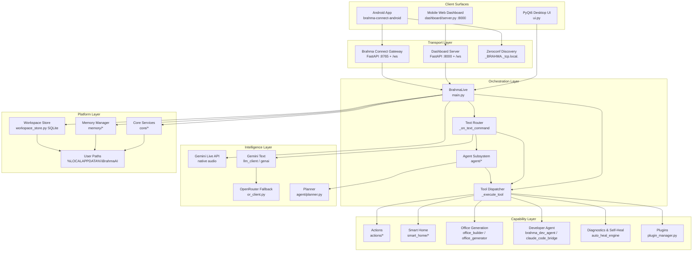

### 3.1 Layer responsibilities

| Layer | Responsibility | Main files |
|---|---|---|
| Client surfaces | Render UI, capture input, show task progress | `ui.py`, `dashboard/static/*`, `brahma-connect-android/**` |
| Orchestration | Own the live session, route commands, dispatch tools | `main.py` |
| Intelligence | Speech reasoning, text generation, planning | Gemini Live, `llm_client.py`, `or_client.py`, `agent/planner.py` |
| Capabilities | Perform concrete actions on the machine, services, and devices | `actions/*`, `smart_home/*`, `plugins/*` |
| Platform | Persistence, configuration, OS integration, safety checks | `core/*`, `memory/*`, `workspace_store.py` |
| Transport | Remote command ingress and device pairing | `brahma_connect/*`, `dashboard/server.py` |

---

## 4. Component Catalogue

### 4.1 Entry point and orchestrator — `main.py`

`main.py` is the centre of the system.

| Symbol | Line | Role |
|---|---:|---|
| `_build_task_plan` | 497 | Splits a request into coarse UI steps. |
| `TOOL_DECLARATIONS` | 595 | JSON schema for all Gemini function-calling tools. |
| `class BrahmaLive` | 1849 | Owns session state, audio queues, tool dispatch, UI updates. |
| `_on_text_command` | 2004 | Deterministic fast-path router and Gemini text bridge. |
| `_build_config` | 3486 | Builds `LiveConnectConfig` with system prompt, memory, time, location, tools, voice. |
| `_execute_tool` | 3544 | Giant `if/elif` dispatch chain for tool names. |
| `_listen_audio` | 4126 | Captures 16 kHz microphone audio. |
| `_receive_audio` | 4191 | Consumes Gemini responses: audio, text, tool calls. |
| `_play_audio` | 4268 | Plays 24 kHz PCM output. |
| `run` | 4307 | Connects/reconnects the live session and starts audio tasks. |
| `main` | 4405 | Boots UI, servers, plugins, daemons, then Qt main loop. |

The class holds:
- `session` — active Gemini Live session.
- `audio_in_queue` — Gemini audio waiting for playback.
- `out_queue` — microphone audio waiting to be sent.
- `_use_openrouter_first` — fallback flag set on Gemini quota/limit errors.
- UI callbacks such as `set_state`, `write_log`, `show_hud_operation`, `update_task_workspace`.
- Smart-home, dashboard, and Brahma Connect service references.

### 4.2 Declared tools

The tool schema is grouped into functional domains:

| Domain | Tools |
|---|---|
| Memory & undo | `undo`, `recall_memory`, `save_memory` |
| Agent & background | `agent_task`, `background_monitor`, `dev_agent` |
| System | `system_manager`, `system_diagnostics`, `auto_heal`, `computer_settings`, `shutdown_brahma` |
| Desktop & input | `open_app`, `computer_control`, `desktop_control`, `smart_organizer`, `screen_process`, `unlock_device` |
| Files & documents | `file_controller`, `file_processor`, `presentation_builder`, `spreadsheet_builder`, `word_document`, `pdf_document` |
| Web & media | `web_search`, `browser_control`, `youtube_video`, `spotify_controller`, `game_updater`, `flight_finder` |
| Communication | `send_message`, `reminder`, `google_workspace`, `calendar_scheduler`, `daily_briefing` |
| Instagram | `check_instagram_messages`, `instagram_reply`, `instagram_send_dm`, `instagram_post_photo`, `instagram_post_reel`, `instagram_get_user_info` |
| Smart home | `smart_home_control` |
| Brahma Connect | `connect_list_devices`, `connect_get_device`, `connect_get_capabilities`, `connect_execute`, `connect_pair_device`, `connect_disconnect_device` |
| Wellness | `calorie_counter`, `pushup_counter` |
| Uploads | `upload_video` |

Each declaration has a name, description, and parameter schema. Gemini chooses tools from this list; the dispatcher must implement a matching branch or the call fails.

### 4.3 Desktop UI — `ui.py`

A large PyQt6 module (~14,300 lines) with three visual identities:

1. **Main window** (`MainWindow`, line 8341) — chat feed, sidebar, task dock, wings, status.
2. **Launcher / floating mode** (`FloatingLauncher`, line 7858; `LauncherControlPanel`, line 4307) — compact always-on-top control surface.
3. **Overlays** — boot sequence, scanning, confirmation, daily briefing, memory inspector, meeting assistant, gesture camera preview.

Notable components:

| Component | Line | Purpose |
|---|---:|---|
| `BackgroundWidget` | 181 | Animated background. |
| `BootSequenceOverlay` | 7311 | Startup animation and step progress. |
| `ScanningOverlay` | 6881 | “Thinking” visual state. |
| `ConfirmationOverlay` | 944 | Explicit yes/no confirmation for risky actions. |
| `DailyBriefingOverlay` | 567 | Morning briefing presentation. |
| `MemoryInspectorOverlay` | 1065 | Browse stored memories. |
| `ConversationFeed` | 2935 | Chat transcript. |
| `TaskDock` | 3146 | Live task/agent progress. |
| `WorkspaceSidebar` | 3247 | Conversations, search, navigation. |
| `BrahmaTelemetryWing` | 4495 | Live operations/source telemetry. |
| `BrahmaResultWing` | 4808 | Tool results and artifacts. |
| `SetupOverlay` | 5541 | First-run API key and configuration. |
| `GestureCameraPreview` | 1690 | MediaPipe hand tracking preview. |
| `SmartDevicesSection` | 12208 | Smart-home device management. |
| `BrahmaConnectDevicesPage` | 12861 | Paired device management. |
| `BrahmaUI` | 13505 | Facade used by `main.py`; wraps `MainWindow`. |

The UI is not thread-safe. Background code calls UI methods that internally marshal to the Qt thread (signals/timers) or tolerates failure with `try/except`.

### 4.4 Core platform services — `core/`

| Module | Responsibility |
|---|---|
| `user_paths.py` | Canonical runtime paths under `%LOCALAPPDATA%\BrahmaAI`. |
| `boot_sentry.py` | Crash recovery on import. If `FATAL_CRASH.log` exists and the last `patch_history.json` entry has `status: applied` plus a valid `backup_path`, it copies the backup over the target, sets status `rolled_back_on_boot`, and archives the crash log as `FATAL_CRASH_RECOVERED.log`. |
| `echo.py` | `EchoGuard` prevents the assistant from hearing its own TTS and supports barge-in. |
| `clipboard_sentry.py` | Watches clipboard changes and can trigger analysis. |
| `window_context.py` | Reads the active window title/process for context. |
| `confirm.py` | Confirmation gate for destructive actions. |
| `undo.py` | In-memory undo stack for file and desktop operations. |
| `learned_rules.py` | Persists user-taught command→action rules. |
| `identity.py` | User identity/profile context. |
| `hotkey.py` | Global hotkey registration. |
| `audio_devices.py` | Enumerates and selects input/output devices. |
| `device_location.py` | Resolves a city for weather/time context. |
| `updater.py` | Git-based self-update helper. |

### 4.5 Agent subsystem — `agent/`

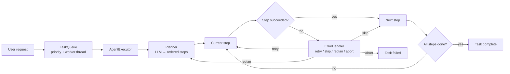

| Module | Responsibility |
|---|---|
| `planner.py` | Uses Gemini text models (`gemini-3.1-flash-lite`, `gemini-3.5-flash`, `gemini-flash-latest` candidates) with `PLANNER_PROMPT` to produce JSON step plans. |
| `executor.py` | Runs steps, adapts tool calls via `_call_tool`, supports retries, generated-code fallback, and a `claude_code` bridge. |
| `task_queue.py` | Thread-safe priority queue with a worker thread and task states. |
| `error_handler.py` | Classifies failures and decides retry, skip, replan, or abort. |

The agent is invoked by the `agent_task` tool and by some fast paths. It is separate from the Gemini Live session: the live model can delegate a complex task to the agent, then report progress through the UI task dock.

### 4.6 Capability modules — `actions/`

The `actions/` package is a flat collection of capability modules. They are not plugins; `_execute_tool` imports them directly or lazily.

| Area | Modules |
|---|---|
| Desktop control | `desktop.py`, `computer_control.py`, `computer_settings.py`, `browser_control.py`, `open_app.py` |
| Files | `file_controller.py`, `file_processor.py`, `pdf_tools.py`, `docx_tools.py` |
| Office | `office_builder.py`, `office_generator.py`, `ppt_template_workflow.py` |
| Web/data | `web_search.py`, `youtube_video.py`, `weather_report.py`, `flight_finder.py`, `spotify_controller.py` |
| Communication | `send_message.py`, `reminder.py`, `google_workspace_mcp.py`, `instagram_mcp.py`, `instagram_chat.py` |
| System | `system_manager.py`, `system_diagnostics_mcp.py`, `auto_heal_engine.py`, `game_updater.py` |
| Desktop awareness | `attention_monitor.py` (notifications/messages), `background_monitor.py` |
| Vision/input | `screen_processor.py`, `clipboard_processor.py` |
| Agent/dev | `brahma_dev_agent.py`, `dev_agent.py`, `claude_code_bridge.py`, `code_helper.py`, `playwright_mcp_client.py` |
| Mobile/remote | `mobile_autopilot.py`, `brahma_connect.py` |
| Wellness | `calorie_counter.py`, `pushup_counter.py` |
| Media | `upload_video.py`, `meeting_assistant.py` |
| Desktop organizing | `desktop_organizer_mcp.py` |

Some “MCP” modules are plain Python wrappers, not real Model Context Protocol servers. The naming reflects intended integration, not a running MCP transport.

### 4.7 Smart home — `smart_home/`

| Module | Responsibility |
|---|---|
| `service.py` | Parses natural-language smart-home commands and executes them. |
| `smart_device_manager.py` | Device registry, routing, state, and command normalization. |
| `storage.py` | SQLite persistence, Fernet-encrypted credentials. |
| `providers/base.py` | Provider abstraction. |
| `providers/builtin.py` | Built-in vendor adapters: Atomberg, Kasa, Hue, LG, Daikin, Tuya, Nest, SmartThings. |

Runtime data:
- `%LOCALAPPDATA%\BrahmaAI\config\smart_home.sqlite3`
- `%LOCALAPPDATA%\BrahmaAI\config\smart_home.key` (Fernet key)

### 4.8 Memory and workspace

| Module | Responsibility |
|---|---|
| `memory/config_manager.py` | Loads/saves API keys and app configuration. |
| `memory/memory_manager.py` | Long-term memory, prompt formatting, token budget. |
| `workspace_store.py` | SQLite conversations, messages, attachments, memories, export. |

`WorkspaceStore` tables include conversations, messages, memories, and key/value state. It also:
- Summarizes long conversations asynchronously.
- Rolls over the active conversation on startup.
- Searches memories for context.
- Exports a conversation to a file.

### 4.9 Brahma Connect gateway — `brahma_connect/`

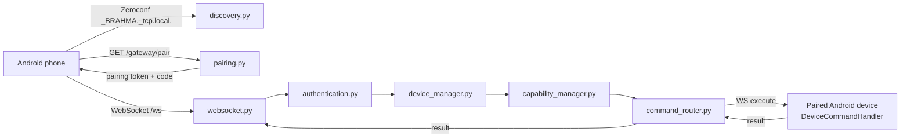

Gateway details:

- Default bind: `0.0.0.0:8765`.
- Pairing offer TTL: 300 seconds.
- Command timeout: 30 seconds.
- WebSocket endpoint: `/ws`.
- Zeroconf service: `_BRAHMA._tcp.local.`.
- Device records include identity fingerprint, secret hash, capabilities, permissions, and online state.
- HTTP endpoints: `/health`, `/gateway/info`, `/gateway/pair`, `/gateway/devices`, `/gateway/devices/{id}/revoke`, `/gateway/devices/{id}/forget`, `/gateway/logs`, `/gateway/pending`, `/gateway/pending/{id}/approve`, `/gateway/pending/{id}/reject`.

The Android client (`brahma-connect-android/`) contains:
- `BrahmaConnectForegroundService` — persistent connection.
- `BrahmaWebSocketClient` — protocol client.
- `BrahmaGatewayDiscovery` — mDNS discovery.
- `PairingPayloadParser` / `PairingStorage` — pairing.
- `BrahmaAccessibilityService` — device-side automation.
- `DeviceCommandHandler` — executes commands locally.
- Compose UI (`ChatScreen`, `BrahmaConnectApp`).

### 4.10 Mobile dashboard — `dashboard/`

FastAPI app served on port `8000`.

| Endpoint | Purpose |
|---|---|
| `GET /` | Main mobile app. |
| `GET /login` | PIN login page. |
| `POST /login` | PIN verification. |
| `GET /auto-login` | Token-based auto-login. |
| `POST /api/device-login` | Device credential login. |
| `POST /api/revoke-devices` | Revoke paired browser devices. |
| `POST /api/command` | Submit a text command. |
| `POST /api/wake` | Wake/activate the assistant. |
| `WS /ws` | Command/result channel. |
| `WS /ws/phone-audio` | Phone microphone audio relay. |
| `POST /api/upload` | File upload, up to 500 MB. |
| `GET /api/files` | List uploads. |
| `GET /uploads/{filename}` | Download upload. |
| `GET /web_background/{filename}` | Serve background assets. |

Security model:
- One-time 6-character PIN.
- Session token after login.
- AES-encrypted command payloads (`crypto-js` on the client).
- Upload size cap.
- LAN binding only in normal use.

### 4.11 Plugins — `plugin_manager.py` + `plugins/`

`PluginManager`:
- Loads every `plugins/*.py` (skipping `__*`) by file path.
- Uses the module attribute `plugin` if present, otherwise the module itself.
- Registers the `BrahmaLive` instance via `register_brahma`, calling `on_brahma_created(brahma)` on each plugin.
- Dispatches hooks by name: `on_startup`, `on_text_command`, and any other hook a plugin defines.
- `dispatch` tries `fn(*args, brahma_echo=..., **kwargs)` first and falls back to `fn(*args, **kwargs)` on `TypeError`.
- If a plugin returns `True` from `on_text_command`, the built-in router stops.

This is the primary extension point that does not require editing `main.py`.

---

## 5. Runtime Process and Thread Model

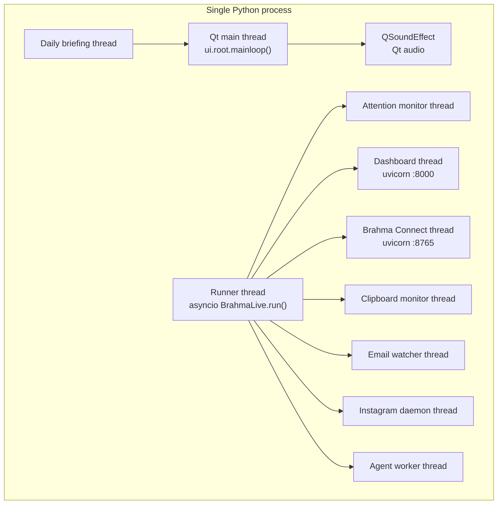

Important consequences:

- All asyncio work for the live session lives on the runner thread's event loop.
- Blocking tools must not run directly on the event loop; most go through `loop.run_in_executor`.
- Qt objects are only safe on the Qt thread. UI helpers are written defensively, but cross-thread misuse remains a risk.
- Servers are daemon threads; when the Qt loop exits, they die with the process.

---

## 6. Startup Workflow

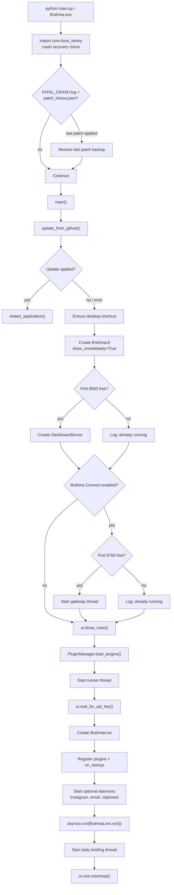

### 6.1 `BrahmaLive.run()` boot sequence

1. Add boot steps to the UI overlay.
2. Start the attention monitor.
3. Start the dashboard asyncio task if present.
4. Create the Gemini client with the API key from `api_keys.json`.
5. Build `LiveConnectConfig`:
   - Response modality `AUDIO`.
   - Input and output audio transcription enabled.
   - System instruction: current date/time, device city, memory, system prompt, wake-word guidance.
   - All `TOOL_DECLARATIONS`.
   - Session resumption handle.
   - Voice `Charon`.
6. Connect with a timeout (`LIVE_CONNECT_TIMEOUT`).
7. Start tasks:
   - `_send_realtime` — forwards queued mic audio to Gemini.
   - `_listen_audio` — captures microphone at 16 kHz.
   - `_relay_phone_audio` — forwards dashboard phone audio.
   - `_receive_audio` — consumes Gemini responses.
   - `_play_audio` — plays 24 kHz PCM output.
8. On any exception, log, set `_use_openrouter_first` if it is a Gemini limit error, clean up, and retry after 5 seconds.

### 6.2 Startup sequence diagram

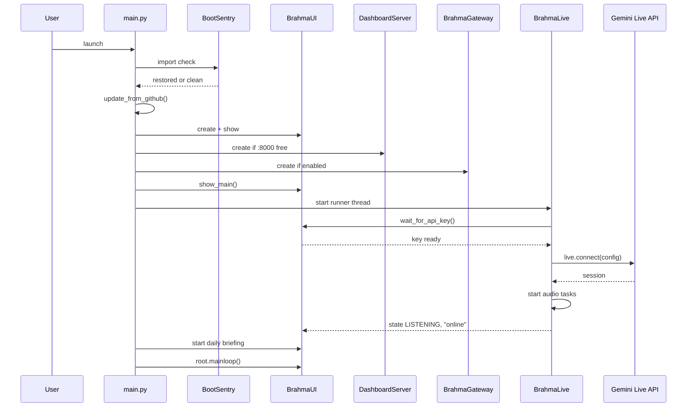

---

## 7. Voice Interaction Workflow

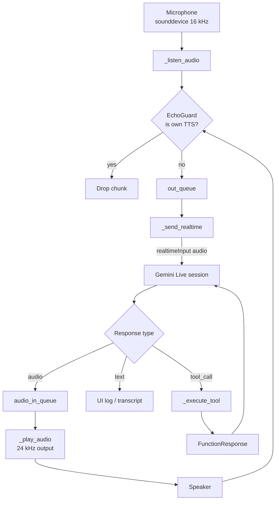

### 7.1 Step-by-step

1. `_listen_audio` opens an input stream at 16 kHz, mono, 16-bit PCM (`SEND_SAMPLE_RATE`, `CHANNELS=1`, `CHUNK_SIZE`), using the configured input device.
2. Each chunk is classified:
   - If the mic is muted and wake-word listening is off, nothing is forwarded.
   - In push-to-talk mode (`_ptt_enabled`) with the key not held, silence is sent instead.
   - If the assistant is speaking, `EchoGuard.is_user_speech` decides. Echo chunks are replaced with silence; a user voice triggers `trigger_barge_in` and is forwarded (an additional raw-level gate `lvl > 28.0` applies).
   - If the assistant is not speaking, chunks below a level gate (`lvl > 10.0`) are replaced with silence; the echo history is reset.
3. Accepted chunks go to `out_queue`.
4. `_send_realtime` drains `out_queue` and sends `realtime_input` audio to Gemini.
5. `_receive_audio` handles three response kinds:
   - **Audio** → `audio_in_queue` → `_play_audio`.
   - **Text** → UI transcript/log.
   - **Tool call** → `_execute_tool` → `FunctionResponse` sent back to Gemini.
6. The model then produces a spoken summary of the tool result.

### 7.1.1 Session parameters

| Parameter | Value |
|---|---|
| Model | `models/gemini-2.5-flash-native-audio-preview-12-2025` |
| Input audio | 16 kHz, mono, 16-bit PCM, chunk size 1024 |
| Output audio | 24 kHz, mono, 16-bit PCM |
| Voice | `Charon` |
| Response modality | `AUDIO` |
| Connect timeout | 12 s |
| Reconnect delay | 5 s |
| Session resumption | Handle stored from `session_resumption_update` and reused in `_build_config` |

### 7.2 Echo cancellation and barge-in

`core/echo.py` implements `EchoGuard`. It does not use a fixed loudness threshold. It:

1. Reduces both the played output and the microphone block to a small set of log-spaced speech band energies (200 Hz–7 kHz).
2. Finds the recent output slice (1.5 s history) that best explains the mic block and subtracts as much of it as fits. The residual is what the mic heard that the assistant did not play.
3. Learns the room's typical echo floor and near-worst echo residual from observed blocks, so the comparison threshold adapts to the actual setup.
4. Reports `reliable = False` when the room is too reverberant to separate on content alone, and then demands more consecutive speech blocks before believing an interruption.

When a user voice is detected while the assistant is speaking:
- `trigger_barge_in` clears the playback queue and stops speech.
- The UI returns to `LISTENING`.
- The user's audio is forwarded to Gemini.

Practical limits:
- Rooms with high echo (loud speakers, reverberation) need longer evidence before interruption, which feels laggy.
- The mic path adds an empirical `lvl > 28.0` gate on barge-in, so a quiet interruption can be missed.
- Push-to-talk mode bypasses voice interruption entirely by sending silence unless the key is held.
- `EchoGuard` is calibrated per run; the learned gain resets on restart.

---

## 8. Text Command Workflow

Text arrives from:
- The desktop chat box (`source="local"`).
- The mobile dashboard (`source="remote"`).
- Brahma Connect commands.
- Plugins or internal callers.

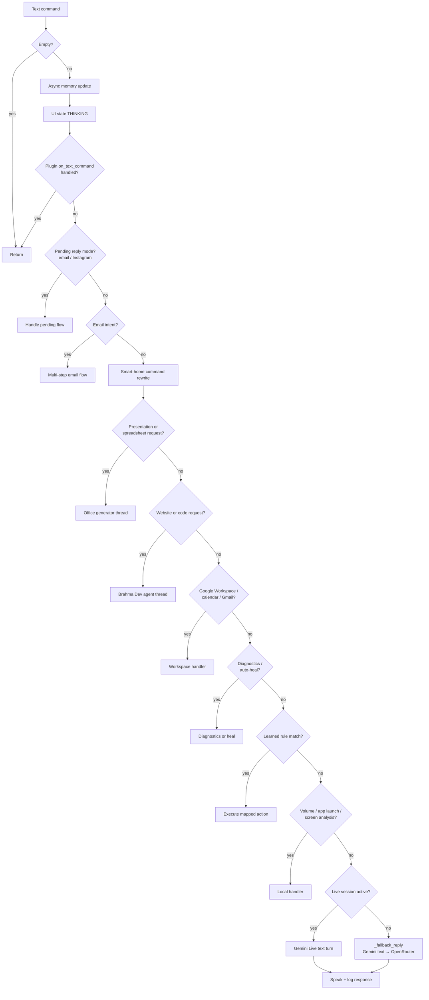

### 8.1 Fast-path rationale

The diagram is a simplification of a long `if/elif` chain; several branches overlap and some are guarded by phrase lists. The current source is authoritative.

The fast paths exist because:
- Multi-step UI flows need deterministic state (email recipient → app → body).
- Office generation needs progress reporting and file output.
- Smart-home commands need device-name rewriting before the LLM sees them.
- Diagnostics and self-heal must be reliable and auditable.
- Learned rules should execute without model latency.

### 8.2 Fallback reply path

`_fallback_reply` is used when the live session is unavailable or a text-only answer is needed:
1. Try Gemini text (`llm_client.py` / `google-genai`).
2. If Gemini is rate-limited or unavailable, try OpenRouter (`or_client.py`).
3. If both fail, return a short error message.

`_use_openrouter_first` is sticky after a Gemini limit error, so subsequent calls go straight to OpenRouter until the process restarts.

---

## 9. Tool Execution Workflow

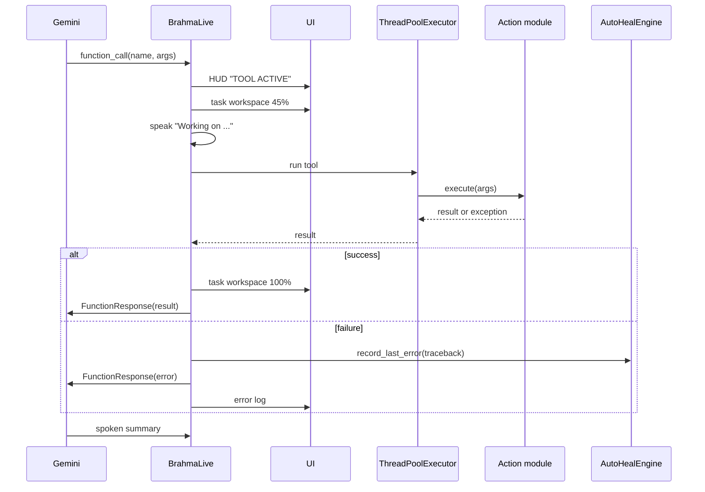

### 9.1 Dispatch mechanics

`_execute_tool` is a long `if/elif` chain keyed on `fc.name`. For each branch it:

1. Normalizes arguments.
2. Updates the HUD and task workspace.
3. Calls the action, usually through `loop.run_in_executor` for blocking I/O.
4. Formats the result as a string.
5. Returns `types.FunctionResponse(name=..., id=fc.id, response={"result": ...})`.
6. Restores UI state to `LISTENING` unless muted.

Failure handling:
- Exceptions are caught.
- `AutoHealEngine.record_last_error` stores the traceback for later analysis.
- The error string is returned to Gemini, which can retry, choose another tool, or explain the failure.

### 9.2 Long-running tools

Long-running work (presentations, code generation, uploads) is moved to a daemon thread and reports progress through `begin_task_workspace` / `update_task_workspace` / `finish_task_workspace`. The live model is not blocked while the thread runs; it speaks an acknowledgement and the UI shows the task.

---

## 10. Agent Task Workflow

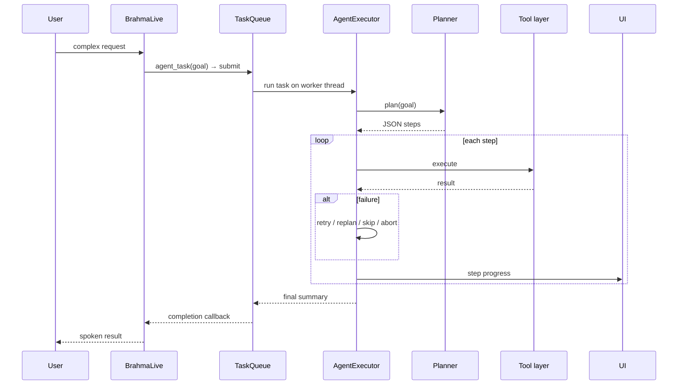

### 10.1 Planner

- Builds a prompt from `PLANNER_PROMPT` plus the goal.
- Requests strict JSON.
- Normalizes steps into an ordered list.
- Falls back across several Gemini model names if one is unavailable.

### 10.2 Executor

- Maps each step to a tool call.
- Supports retries with a fixed 2-second delay (up to 3 attempts per step).
- Can generate a Python script and execute it when no tool fits.
- Can delegate to `claude_code_bridge`.
- Reports progress to the UI task dock.

### 10.3 Error handler

`analyze_error` asks Gemini (`gemini-3.1-flash-lite`) with `ERROR_ANALYST_PROMPT` to classify the failure and return JSON:

- **Retry** for transient failures (timeouts, file locks).
- **Skip** for non-critical steps.
- **Replan** when the approach is wrong or the attempt cap is reached.
- **Abort** when the task is impossible or unsafe.

Hard rules override the model:
- At `attempt >= max_attempts`, the decision is forced to `replan`.
- A `skip` on a step marked `critical` is converted to `replan`.
- If the analysis call fails or returns invalid JSON, the fallback is `replan`.

`generate_fix` then produces a replacement step, often using generated code as the fallback path.

---

## 11. Self-Healing Workflow

`actions/auto_heal_engine.py` implements a guarded patch pipeline.

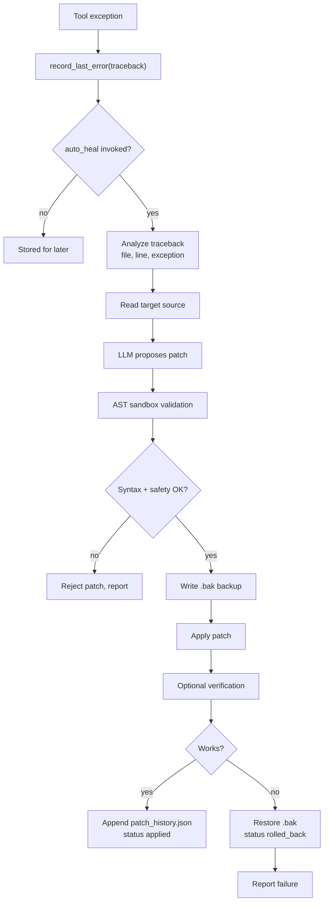

Safety properties:
- Backups are written before modification to `%LOCALAPPDATA%\BrahmaAI\config\patch_backups\<name>.bak_<stamp>.py`.
- Patches are parsed with `ast.parse` before writing.
- Patch history records `applied` or `rolled_back`, plus the explanation and backup path.
- `BootSentry` restores the backup if the next start finds `FATAL_CRASH.log` and the last patch is still `applied`.
- The engine is scoped to the file named in the traceback.

Limitations:
- AST validation checks syntax, not semantic safety.
- No test suite is guaranteed to run after a patch.
- Rollback restores the backup, so unrelated edits made after the backup are lost.

---

## 12. Brahma Connect Workflow

### 12.1 Pairing and command flow

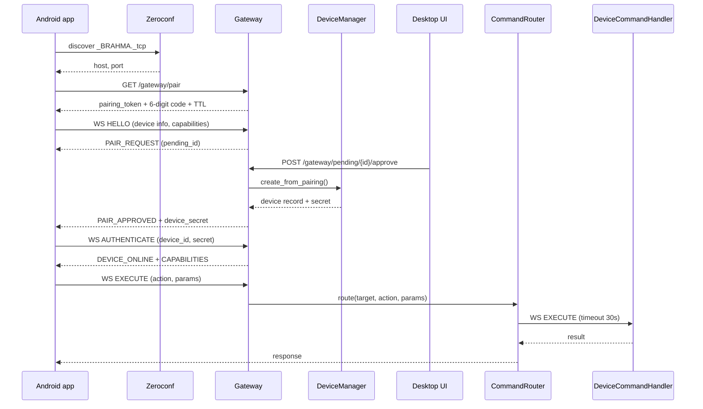

### 12.2 Device capabilities

Capabilities are free-form strings reported by the device during pairing. `CapabilityManager` normalizes them to lower-case snake_case, de-duplicates, sorts, and provides:

- `supports(capabilities, capability)` — membership test.
- `missing(capabilities, required)` — list of unmet requirements.

The gateway rejects commands when a required capability is missing. There is no fixed global capability vocabulary in the code; the set is defined by the client implementation and the registered actions. Treat capability checks as a consistency guard, not a security boundary.

### 12.3 Trust boundary

Brahma Connect is intended for a trusted LAN. It binds `0.0.0.0` by default, so any host on the network can reach the HTTP endpoints. Pairing requires a short-lived token and code, but the transport is plain HTTP/WS unless a reverse proxy adds TLS. Do not expose port `8765` to the public internet.

---

## 13. Mobile Dashboard Workflow

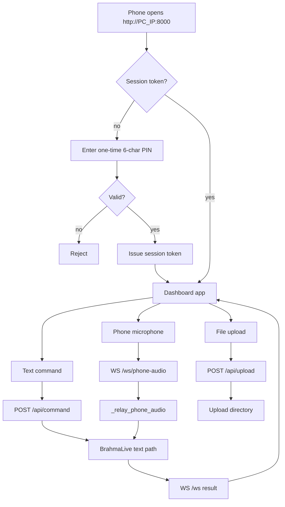

Notes:
- The PIN is generated on demand (`DashboardServer.new_key()`): 6 characters, 600-second TTL, single use. `main.py` exposes it through the Mobile Connect UI flow along with the LAN URL.
- The dashboard is deliberately simple HTML/JS (`app.html`, `login.html`) with `crypto-js` on the client and AES-CBC payload decryption on the server.
- Uploads are capped at 500 MB and served from a dedicated directory.
- `_serve_dashboard` and `_consume_remote_commands` run as asyncio tasks inside `BrahmaLive.run()`.

---

## 14. Smart-Home Workflow

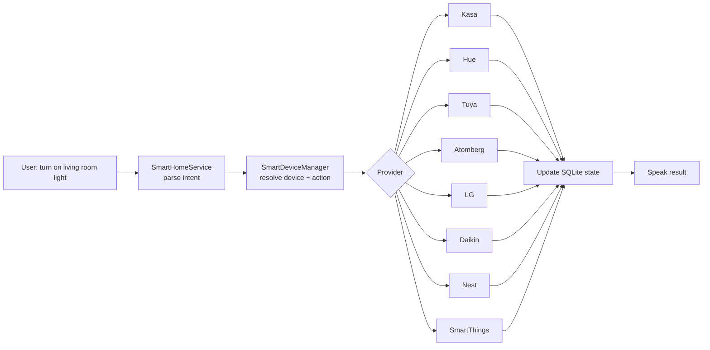

Flow:
1. `_on_text_command` calls `SmartDeviceManager.route_command` before the LLM to normalize device names and aliases.
2. `SmartHomeService` parses the intent.
3. `SmartDeviceManager` resolves the target device and capability.
4. The provider adapter performs the vendor API call.
5. State is written to `smart_home.sqlite3`.
6. Credentials are encrypted with Fernet; the key is stored separately.

Failure modes:
- Vendor cloud outages.
- Expired OAuth tokens.
- Devices that report state but reject commands.
- Ambiguous device names across rooms.

The service returns a human-readable error, which the assistant speaks.

---

## 15. Memory and Persistence

### 15.1 Runtime data map

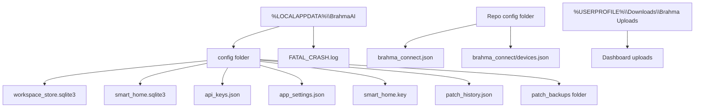

| Data | Location | Notes |
|---|---|---|
| API keys | `config/api_keys.json` | Plain JSON; file-system permissions are the only protection. |
| App settings | `config/app_settings.json` | UI preferences, startup behavior. |
| Conversations | `config/workspace_store.sqlite3` | Messages, attachments, summaries, memories. |
| Long-term memory | `config/workspace_store.sqlite3` + `memory/` | Memory entries with categories and keys. |
| Smart-home state | `config/smart_home.sqlite3` | Devices, rooms, states. |
| Smart-home key | `config/smart_home.key` | Fernet key. |
| Brahma Connect config | `<repo>/config/brahma_connect.json` | Port, enabled flag, pairing settings. |
| Brahma Connect devices | `<repo>/config/brahma_connect/devices.json` | Paired device registry. |
| Patch history | `config/patch_history.json` | Self-heal audit trail. |
| Patch backups | `config/patch_backups/` | Timestamped `.bak_<stamp>.py` files. |
| Crash log | `FATAL_CRASH.log` | Written by `__main__` on fatal error. |
| Uploads | `~/Downloads/Brahma Uploads` (fallback: `~/Documents/Brahma Uploads`, then `<repo>/uploads`) | Dashboard file uploads. |

### 15.2 Memory pipeline

1. Every non-trivial user text starts `_update_memory_async`.
2. `WorkspaceStore.record_chat` persists the message pair.
3. `_ingest_memory` extracts candidate facts.
4. `memory_manager` formats relevant memories into the system instruction.
5. `recall_memory` searches on demand.
6. `save_memory` writes explicit facts.
7. Long conversations are summarized asynchronously to control prompt size.

### 15.3 Prompt and storage budget

`memory_manager` separates storage growth from prompt size:

- `MEMORY_MAX_CHARS = 200_000` is a runaway guard, not a feature limit. When exceeded, the oldest entries are trimmed and a notifier can fire.
- `MAX_VALUE_LENGTH = 380` truncates individual values.
- `PROMPT_MAX_PER_CATEGORY = 6` limits how many entries per category are injected into the system instruction.

The prompt limit is category-based, not a model-aware token count. A category with unusually long values can still produce a large prompt.

---

## 16. UI State and Event Flow

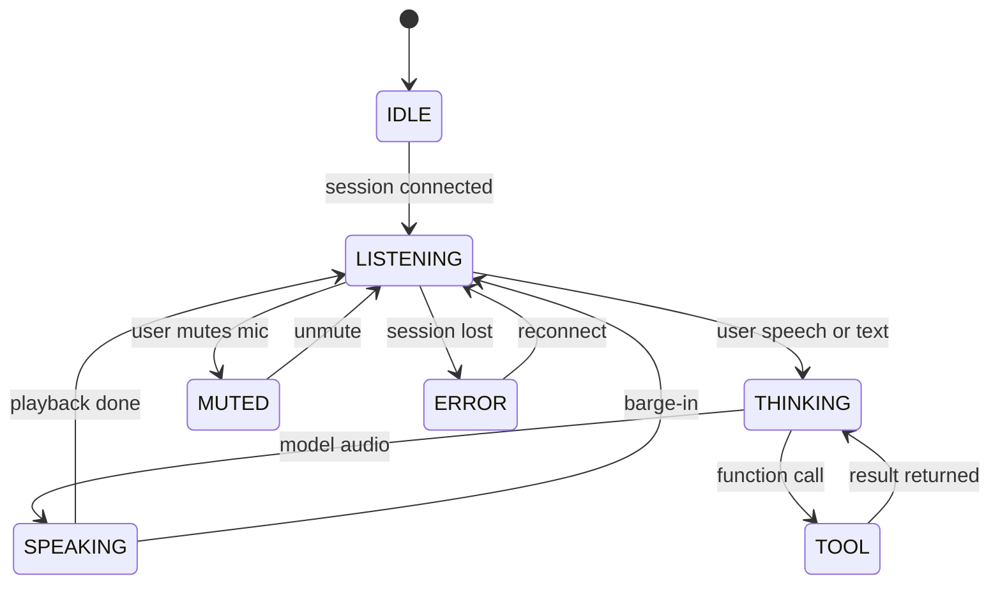

UI updates are driven by:
- `ui.set_state(...)` for the main state.
- `ui.write_log(...)` for transcript lines.
- `ui.show_hud_operation(...)` for telemetry.
- `ui.begin_task_workspace` / `update_task_workspace` / `finish_task_workspace` for multi-step tasks.
- `ui.boot_add_step` / `boot_set_step_status` / `boot_set_progress` for startup.

The task workspace is the main mechanism for long-running operations. It shows a title, status, output, and percent, and is updated from worker threads.

---

## 17. Office and Document Generation

`actions/office_builder.py` and `actions/office_generator.py` create:

- PowerPoint (`.pptx`) via `python-pptx`.
- Excel (`.xlsx`) via `openpyxl`.
- Word (`.docx`) via `python-docx`.
- PDF via `reportlab`.

Output rules:
- Default directory: `~/Desktop/BrahmaAI`.
- Relative paths are resolved against Desktop, Downloads, or the current directory.
- Filenames are sanitized; extensions are enforced.
- JSON arguments are accepted as dicts or JSON strings.

The high-level generator (`generate_presentation_from_prompt`, `generate_spreadsheet_from_prompt`) asks the LLM for structured content, then calls the builder. The fast path in `_on_text_command` runs this in a daemon thread and reports progress to the task workspace.

This is a template-driven pipeline, not a full layout engine. Complex slide layouts, charts, and brand systems are approximated.

---

## 18. Screen, Gesture, and Vision

### 18.1 Screen processing

`actions/screen_processor.py`:
- Captures the screen with `mss`.
- Resizes to at most 640×360 and JPEG quality 55.
- Sends the image to Gemini for analysis.
- Optionally listens to audio for context.
- Uses a short system prompt for concise answers.

The `screen_process` tool exposes this to the live model.

### 18.2 Gestures

`gesture_utils.py` recognizes:
- Open palm → play/pause.
- Swipe right → next track/slide.
- Swipe left → previous track/slide.
- Thumbs up/down → volume.
- Peace sign → screenshot.
- Pinch → mouse click.

`ui.py` renders the camera preview and cursor. MediaPipe provides the hand landmarks. Gesture control is optional and depends on camera availability and lighting.

### 18.3 Attention monitor

`actions/attention_monitor.py` runs a background thread that watches for desktop notifications and message events (toast payloads, notification-shaped windows, known chat apps such as Discord, WhatsApp, Telegram, Slack, Teams, Gmail, and Outlook). It:

- Normalizes app names and message previews.
- Emits events with app, sender, and preview text.
- Supports focus/click actions on the source app.
- Provides native speech helpers (`speak_native`, `stop_native_speech`) using `edge-tts`.

It is not a camera-based presence system. It is Windows-centric and relies on window/notification heuristics.

---

## 19. Security and Trust Model

### 19.1 Assets

- Gemini and OpenRouter API keys.
- Google Workspace OAuth credentials.
- Instagram credentials/session.
- Smart-home vendor tokens.
- Brahma Connect device secrets.
- Dashboard session tokens.
- User conversations and memories.

### 19.2 Controls present

| Control | Where |
|---|---|
| Confirmation overlay for risky actions | `core/confirm.py`, `ui.py` |
| Undo stack | `core/undo.py` |
| Self-heal backups and rollback | `actions/auto_heal_engine.py` |
| Fernet encryption for smart-home credentials | `smart_home/storage.py` |
| Pairing TTL and device secret hashes | `brahma_connect/gateway/pairing.py` |
| Dashboard PIN + session tokens | `dashboard/server.py` |
| Upload size limit | `dashboard/server.py` |
| LAN-oriented binding | Both servers |

### 19.3 Gaps and risks

1. **Plaintext API keys.** `config/api_keys.json` is unencrypted. Any process running as the user can read it.
2. **No TLS by default.** Brahma Connect and the dashboard use HTTP/WS. Credentials and commands are visible to the LAN unless a proxy adds TLS.
3. **Broad bind address.** `0.0.0.0` exposes services to every network interface, including public Wi-Fi.
4. **Prompt injection.** Screen text, web pages, emails, and clipboard content are untrusted inputs to the LLM. A malicious page could attempt to trigger tools.
5. **Tool authority.** The model can invoke file, desktop, and shell-adjacent tools. Confirmation coverage is not universal across all branches.
6. **Self-heal scope.** The patcher can modify source files. AST validation does not prove semantic safety.
7. **Plugin trust.** Plugins are arbitrary Python modules with full process privileges.
8. **Clipboard monitoring.** Clipboard content is sent to Gemini for analysis; sensitive data can leave the machine.
9. **Android accessibility.** The Android app requests accessibility permissions, which are powerful and sensitive.
10. **No sandbox.** Actions run with the user's full privileges.

### 19.4 Hardening recommendations

- Move secrets to Windows Credential Manager or DPAPI.
- Bind servers to `127.0.0.1` by default and require explicit LAN opt-in.
- Add TLS or a local reverse proxy for remote access.
- Add a per-tool permission policy and audit log.
- Treat all retrieved content as untrusted and require confirmation for state-changing tools.
- Sandbox generated code and self-heal patches.
- Sign plugins and load only from a trusted directory.
- Encrypt or redact clipboard and screen data before sending.

---

## 20. Error Handling and Resilience

| Failure | Detection | Response |
|---|---|---|
| Gemini Live disconnect | Exception in `run()` | Reconnect after 5 s, session resumption handle reused if available. |
| Gemini quota/limit | `_is_gemini_limit_error` | Set `_use_openrouter_first`, retry with OpenRouter. |
| Tool exception | `try/except` in `_execute_tool` | Record traceback, return error string to model, UI log. |
| Planner model unavailable | Model candidate loop | Try next Gemini model. |
| Agent step failure | `ErrorHandler` | Retry, skip, replan, or abort. |
| Dashboard port busy | `_is_port_in_use(8000)` | Disable dashboard, log message. |
| Gateway port busy | `_is_port_in_use(8765)` | Disable gateway, log message. |
| Fatal crash | `FATAL_CRASH.log` | `BootSentry` restores `.bak` if last patch was applied. |
| Audio device missing | `sounddevice` exception | Log and continue; session may run without audio. |
| Plugin import error | `PluginManager.load_plugins` | Skip plugin, keep loading others. |
| Missing API key | `ui.wait_for_api_key()` | Block runner until setup completes. |

Known resilience gaps:
- The reconnect loop has no exponential backoff; it reconnects every 5 seconds indefinitely.
- A permanently failing tool can still be retried by the model.
- The dashboard and gateway threads can die without restarting the process.
- Self-heal can patch the same file repeatedly if the fix is wrong but syntactically valid.

---

## 21. Extensibility

### 21.1 Adding a tool

1. Add a schema entry to `TOOL_DECLARATIONS` in `main.py`.
2. Add an `elif name == "your_tool":` branch in `_execute_tool`.
3. Implement the action in `actions/your_tool.py`.
4. Return a string or JSON-serializable result.
5. Update the UI task workspace on long operations.
6. Add a test if the action has non-trivial logic.

### 21.2 Adding a plugin

1. Create `plugins/your_plugin.py`.
2. Optionally assign a `plugin` object; otherwise the module itself is used.
3. Define `on_brahma_created(brahma_echo)`, `on_startup(brahma_echo)`, and/or `on_text_command(text, source)`.
4. Return `True` from `on_text_command` to consume the command.
5. Place the file in `./plugins`; `PluginManager` loads it at boot. A broken plugin is skipped with a log line.

### 21.3 Adding a smart-home provider

1. Subclass the provider base in `smart_home/providers/`.
2. Implement discovery, auth, state read, and command write.
3. Register it in `builtin.py`.
4. Add credential fields and encryption handling.
5. Add a device capability mapping.

### 21.4 Adding an Android capability

1. Implement the command in `DeviceCommandHandler`.
2. Declare the capability during pairing.
3. Update `capability_manager.py` on the gateway.
4. Add a UI action in `ChatScreen`.

---

## 22. Known Limitations and Technical Debt

1. **`main.py` is monolithic.** `BrahmaLive` and `_execute_tool` mix orchestration, UI, and tool logic. This makes testing and reasoning hard.
2. **Duplicated model clients.** `google-genai`, `google-generativeai`, `llm_client.py`, and `or_client.py` coexist with different APIs and model names.
3. **Inconsistent tool error contracts.** Some tools return strings, some dicts, some raise. The dispatcher normalizes ad hoc.
4. **Thread safety.** UI calls from worker threads rely on defensive wrappers rather than a strict signal/slot boundary.
5. **No unified configuration schema.** Settings are spread across JSON files, environment variables, and hard-coded defaults.
6. **Hard-coded ports.** `8000` and `8765` are fixed; conflicts disable features rather than selecting alternatives.
7. **No database migrations.** SQLite schemas are created with `CREATE TABLE IF NOT EXISTS`; schema changes need manual handling.
8. **Memory extraction is heuristic.** It can store noise or miss important facts.
9. **LLM-dependent planning.** Planner quality varies by model and prompt; JSON parsing is brittle.
10. **Self-heal is risky.** It modifies live source code with limited verification.
11. **Test coverage is narrow.** Tests exist for Brahma Connect, gestures, and the screen processor, but not for the main orchestration loop.
12. **README overclaims.** Features described as fully autonomous may be partially implemented or depend on external services.
13. **Windows-centric.** Many actions use `pyautogui`, `pygetwindow`, `pycaw`, `comtypes`, and Windows paths. Cross-platform support is limited.
14. **“MCP” naming.** Several modules named `*_mcp` are direct API wrappers, not MCP servers.
15. **No structured telemetry.** Logs are print statements and UI lines, not a queryable event stream.
16. **Duplicate task startup.** `BrahmaLive.run()` creates `_relay_phone_audio()` both before the reconnect loop and inside the connected `TaskGroup`, so two relay tasks can run concurrently after a successful connect. `main()` also calls `ui.show_main()` twice.
17. **Stale comments.** `core/echo.py` says barge-in “stays switched off”, but `_listen_audio` calls `trigger_barge_in` and applies an extra `lvl > 28.0` gate.

---

## 23. File Map

```text
Brahma-Echo-main/
├── main.py                     # Entry point, BrahmaLive, tools, audio loop
├── ui.py                       # PyQt6 UI, overlays, pages, launcher
├── workspace_store.py          # SQLite conversations/memories
├── plugin_manager.py           # Plugin loader and hooks
├── llm_client.py               # Gemini text client
├── or_client.py                # OpenRouter fallback
├── sound_manager.py            # Procedural UI sound effects
├── gesture_utils.py            # Hand landmark → gesture mapping
├── updater.py                  # Update helper
├── discord_bot.py              # Optional Discord integration
│
├── core/
│   ├── boot_sentry.py          # Crash recovery
│   ├── echo.py                 # Echo cancellation / barge-in
│   ├── confirm.py              # Confirmation gate
│   ├── undo.py                 # Undo stack
│   ├── learned_rules.py        # User-taught rules
│   ├── clipboard_sentry.py     # Clipboard watcher
│   ├── window_context.py       # Active window context
│   ├── identity.py             # User identity
│   ├── hotkey.py               # Global hotkeys
│   ├── audio_devices.py        # Audio device enumeration
│   ├── device_location.py      # City resolution
│   ├── user_paths.py           # Runtime paths
│   └── updater.py              # Git update logic
│
├── agent/
│   ├── planner.py              # LLM planning
│   ├── executor.py             # Step execution
│   ├── task_queue.py           # Priority queue
│   └── error_handler.py        # Retry/replan policy
│
├── actions/                    # Capability modules (see §4.6)
│
├── smart_home/
│   ├── service.py              # Intent parsing/execution
│   ├── smart_device_manager.py # Device routing
│   ├── storage.py              # SQLite + Fernet
│   └── providers/              # Vendor adapters
│
├── memory/
│   ├── config_manager.py       # API keys/settings
│   └── memory_manager.py       # Long-term memory
│
├── brahma_connect/
│   ├── service.py              # Service facade
│   └── gateway/
│       ├── server.py           # FastAPI gateway
│       ├── websocket.py        # WS protocol
│       ├── pairing.py          # Pairing tokens
│       ├── authentication.py   # Device auth
│       ├── device_manager.py   # Device registry
│       ├── capability_manager.py
│       ├── command_router.py   # Command routing/timeouts
│       ├── discovery.py        # Zeroconf
│       ├── protocol.py         # Message schemas
│       └── models.py           # Data models
│
├── dashboard/
│   ├── server.py               # Mobile web server
│   └── static/                 # login.html, app.html, crypto-js
│
├── brahma-connect-android/     # Kotlin Android client
│   └── app/src/main/java/com/brahma/connect/
│       ├── network/            # WS client, discovery
│       ├── pairing/            # Pairing storage/parser
│       ├── accessibility/      # Accessibility service
│       ├── commands/           # Device command handler
│       ├── core/               # Models, state store
│       └── ui/                 # Compose UI
│
├── plugins/                    # User plugins
├── tests/                      # Pytest suite
├── assets/                     # Logo and sounds
├── config/                     # Repo-level defaults (runtime uses LOCALAPPDATA)
├── bootstrap.ps1               # Dependency/bootstrap script
├── start_brahma.bat            # Windows launcher
├── start_brahma.vbs            # Silent launcher
└── requirements.txt
```

---

## 24. End-to-End Example

**User says:** “Create a presentation about renewable energy and save it to my Desktop.”

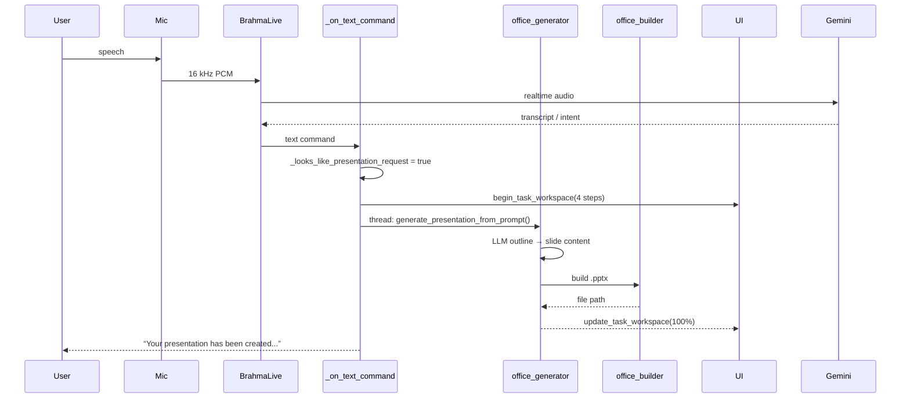

Actual path:
1. Audio is transcribed by Gemini Live.
2. `_on_text_command` detects a presentation request before the general LLM path.
3. A daemon thread calls `generate_presentation_from_prompt`.
4. The generator asks the LLM for an outline and slide content.
5. `office_builder` writes the `.pptx` to `~/Desktop/BrahmaAI`.
6. Progress is shown in the task workspace.
7. The assistant speaks a completion message.

If generation fails, the error is logged, the task workspace shows `Generation Failed`, and the assistant speaks an apology. No partial file is guaranteed to be cleaned up.

---

## 25. Summary

Brahma Echo is a **single-process, voice-first Windows assistant** with a layered but tightly coupled design:

- **Gemini Live** provides the conversational audio loop.
- **`main.py`** is the orchestrator and the largest source of coupling.
- **Tools and actions** provide broad OS and service control.
- **Agent planning** adds multi-step autonomy.
- **Self-healing** adds runtime code repair with backups.
- **Brahma Connect + dashboard** add remote surfaces.
- **SQLite + LOCALAPPDATA** provide local persistence.
- **Plugins** are the cleanest extension point.

The architecture is pragmatic and feature-rich, but its security posture assumes a trusted local machine and a trusted LAN. The highest-value refactors are: split `BrahmaLive` and `_execute_tool`, unify model clients, add a permission/audit layer for tools, encrypt secrets, and sandbox self-heal and generated code.
